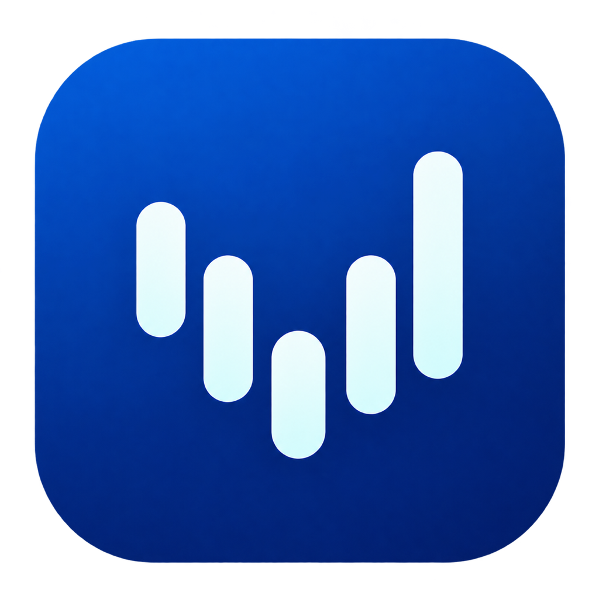
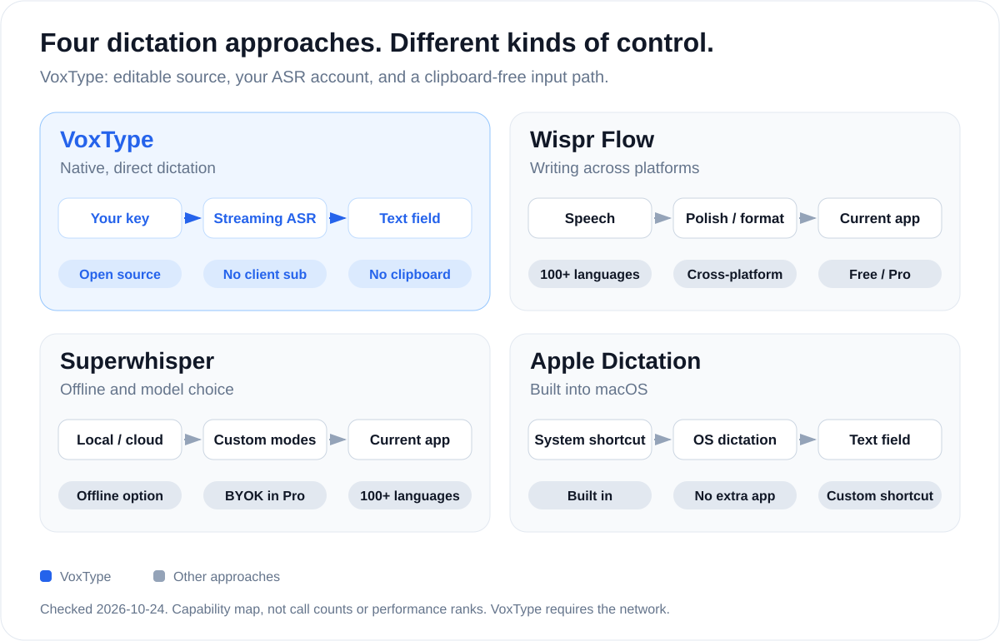
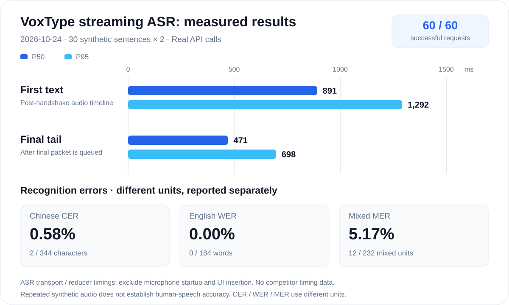

  

<h1 align="center">VoxType</h1>

  <strong>Lightweight, open-source dictation for Mac.</strong>

Chinese and English, straight to your cursor. No client subscription.

  
  

  English · <a href="README.zh-CN.md">简体中文</a>

## Why VoxType

- **Direct input, preserved clipboard.** Accessibility writes or Unicode keyboard events deliver your words. Only an explicit Copy Last Result action changes the clipboard.
- **Streaming text with sentence-final correction.** Supported fields show live text; finalized ASR results correct the current sentence. Other fields use automatic sentence-final or release-time delivery.
- **Your words, without an extra rewriting call.** ASR handles transcription, punctuation and sentence-final correction; the client adds no separate LLM rewriting step.
- **A small native utility.** Menu bar, configurable shortcut, Keychain credentials and login startup. No Electron, helper server or bundled model weights.

Field compatibility depends on the target application's accessibility support. If direct delivery cannot be confirmed, the app stops rather than retrying with clipboard paste.

## How it compares

Official product capabilities checked 2026-10-24. This is a capability map, not a network-call diagram or measured performance ranking. Both commercial alternatives offer free tiers. [Sources and scope](docs/images/README.md).

## Measured, not guessed

The 2026-10-24 evaluation used **30 synthetic sentences × 2 repetitions**, with real Doubao calls. Timings cover ASR transport and result reduction, excluding microphone startup and visible field insertion. No competitor was timed in this run. [Raw results and limits](benchmarks/RESULTS.md) · [Reproduce the test](benchmarks/README.md).

The measured baseline app contained **2.21 MiB** of file contents, including its icon and signature, with a **754 KiB** executable. These are snapshot measurements; build sizes can change. `Package.swift` declares **0 remote package dependencies**.

## A short path to speaking

You need **an Apple Silicon Mac running macOS 15+**, a network connection, and your own enabled **Volcengine Doubao Streaming ASR 2.0** account/key.

The client is free and needs no VoxType account. Bring your own Doubao ASR key; provider usage charges apply.

1. Build/install the native app using [the build guide](docs/BUILDING.md).
2. Open Settings from the menu bar; save your API key and choose a shortcut.
3. Grant Microphone, Accessibility and Input Monitoring permissions.
4. Focus a text field, hold the shortcut and speak. Release to finish; edit the inserted text normally.

The repository currently documents a **local build**, not a notarized public installer. Full setup and fallback behavior are in [Getting started](docs/GETTING_STARTED.md).

## Privacy and boundaries

- Your key is stored in **macOS Keychain**, not a project configuration file.
- Audio is sent to **Volcengine/ByteDance's ASR endpoint** while dictating. This is cloud recognition; provider terms and retention policies apply.
- No recording archive or transcript-history database is implemented. The latest result remains in memory for an explicit “copy last result” action.
- Accessibility APIs inspect the focused field to deliver and verify text. Fallback uses direct Unicode keyboard events, never clipboard paste. Only the explicit “copy last result” action changes the clipboard. The recording indicator can display recognized text on screen.
- The idle code path does not start microphone capture or an ASR session. No separate analytics integration exists in the inspected source.

Read [the data-flow and permission notes](docs/PRIVACY.md). Real microphone conditions, accents, Bluetooth devices and application compatibility need broader testing than a controlled ASR sample set.

## Inside the project

`VoxTypeApp` handles the menu bar, settings, microphone, shortcuts and guarded text insertion. `VoxTypeCore` contains the streaming protocol, recognition reducer and delivery/session policies. A small C wrapper uses system zlib for gzip; no model weights are bundled.

Contributions improving text-delivery reliability, real-world bilingual evaluation and reproducible builds are welcome. Include the environment and a minimal reproduction; keep credentials and private transcripts out of issues.

## License

**[Apache License 2.0](LICENSE)**. See [NOTICE](NOTICE) for attribution and [third-party notes](docs/THIRD_PARTY.md) for scope. The license covers this project's original work; ASR service access remains subject to provider terms and fees.
