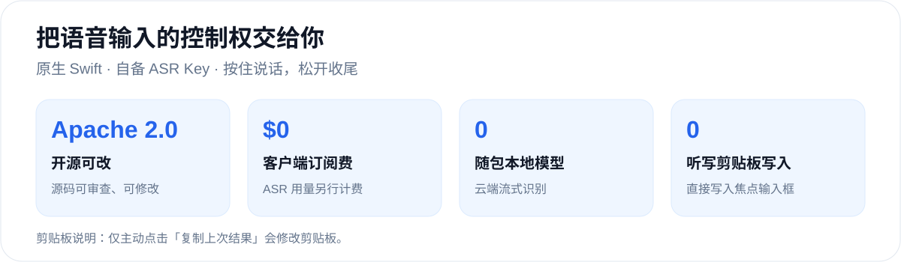
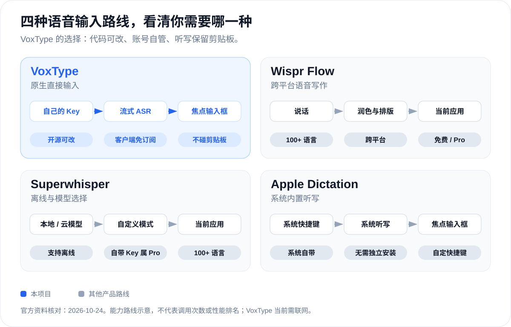
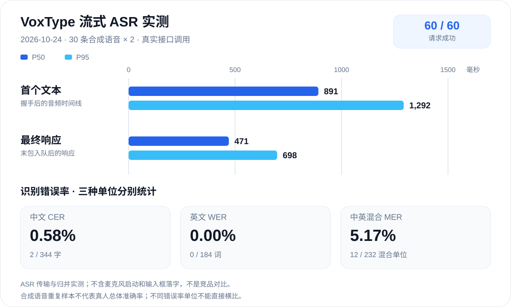

  

<h1 align="center">VoxType</h1>

  <strong>开源可改、免客户端订阅、无需下载模型，语音直写光标、不占剪贴板。</strong>

按住快捷键，说中文、英文或中英混合，让文字直接出现在你正在工作的输入框。

客户端免费；自备豆包 ASR Key，语音识别用量仍按服务商规则计费。

  
  
  
  

  <a href="README.md">English</a> · 简体中文 
  <a href="#为什么选择-voxtype">产品特点</a> · <a href="#与其他方案的区别">竞品对比</a> · <a href="#用实测说明体验">实测数据</a> · <a href="docs/GETTING_STARTED.md">开始使用</a>

## 为什么选择 VoxType

**如果你需要的是一个可以检查和修改、免客户端订阅、装上不用再配置本地模型的 Mac 语音输入工具，VoxType 就为这个需求而做。** 原生 Swift 客户端直接连接你自己账号下的豆包流式语音识别 2.0，把文字写进当前输入框。源码和识别账号由你掌控，无需注册 VoxType 账号或部署中转服务。

- **直接输入，保留剪贴板。** 通过辅助功能或 Unicode 键盘事件写入；只有主动选择「复制上次结果」才修改剪贴板。
- **边说边出字，句末纠正。** 支持安全修改范围的输入框实时更新；其他输入框在句末或松开后自动输入。
- **转写你的表达。** 使用 ASR 的识别、标点和句末纠正，不增加单独的大模型改写调用。
- **精简的原生工具。** 菜单栏、自定义快捷键、钥匙串和登录自启，没有 Electron、常驻后端或随包分发的模型权重。

兼容性取决于目标应用的辅助功能支持；无法确认直接输入成功时会停止，避免重复输入，也不改走剪贴板粘贴。

## 与其他方案的区别

官方功能核对日期：2026-10-24。这是能力路线图，不代表网络调用次数或实测性能排名；两款商业工具也提供免费档。[资料来源与范围](docs/images/README.md)。

## 用实测说明体验

2026-10-24 使用 **30 条合成语音 × 2 次**真实调用豆包。延迟统计涵盖 ASR 传输与结果归并，不包括麦克风启动和输入框可见落字；此次没有竞品计时数据。[原始结果与限制](benchmarks/RESULTS.md) · [复现测试](benchmarks/README.md)。

已测基线包的文件逻辑大小合计 **2.21 MiB**，包含图标与签名；可执行文件 **754 KiB**。这是特定构建的快照，后续构建体积会变化；`Package.swift` 声明 **0 个远程包依赖**。

## 简单开始

需要 **Apple 芯片 Mac、macOS 15 或更新版本**、网络连接，以及已开通的 **火山引擎豆包流式语音识别 2.0** 账号和 API Key。

1. 按 [构建说明](docs/BUILDING.md) 构建并安装原生应用。
2. 从菜单栏打开设置，保存 API Key，设置听写快捷键。
3. 授予麦克风、辅助功能和输入监控权限。
4. 将光标放进输入框，按住快捷键说话，松开收尾；输入后可继续正常编辑。

仓库目前提供的是 **本地构建方式**，不是已通过 Apple 公证的公开安装包。详细操作及回退行为见 [使用说明](docs/GETTING_STARTED.md)。

## 隐私与适用边界

- API Key 保存到 **macOS 钥匙串**，不写入项目配置文件。
- 听写时会把音频发送到 **火山引擎／字节跳动的 ASR 接口**。这是云端识别，服务商的数据处理条款仍然适用。
- 应用没有录音归档或转写历史数据库；最近一次结果暂存在内存中，供用户主动选择「复制上次结果」。
- 为了输入和校验文字，会通过辅助功能读取当前焦点输入框；回退使用 Unicode 键盘事件直接输入，听写过程不读写剪贴板。只有主动选择「复制上次结果」才会修改剪贴板。录音状态提示可能在屏幕上显示识别文字。
- 空闲代码路径不启动麦克风采集或 ASR 会话；已检查源码未接入独立的统计分析服务。

详见 [数据流和权限说明](docs/PRIVACY.md)。真实麦克风、口音、蓝牙设备及不同应用的兼容性，还需要比受控 ASR 样本更广泛的验证。

## 项目实现

`VoxTypeApp` 负责菜单栏、设置、录音、快捷键和文字写入；`VoxTypeCore` 负责流式协议、结果归并、输入和会话策略。少量 C 代码调用系统 zlib 处理 gzip，不附带模型权重。

欢迎贡献输入兼容性修复、中英真实语音测试和可复现构建改进。反馈问题时请附环境和最小复现，避免在 Issue 中上传密钥或私人语音内容。

## 开源协议

采用 **[Apache License 2.0](LICENSE)**。项目署名见 [NOTICE](NOTICE)，第三方范围见 [说明](docs/THIRD_PARTY.md)。协议适用于项目原创内容，语音识别服务的使用仍受服务商条款与计费规则约束。
